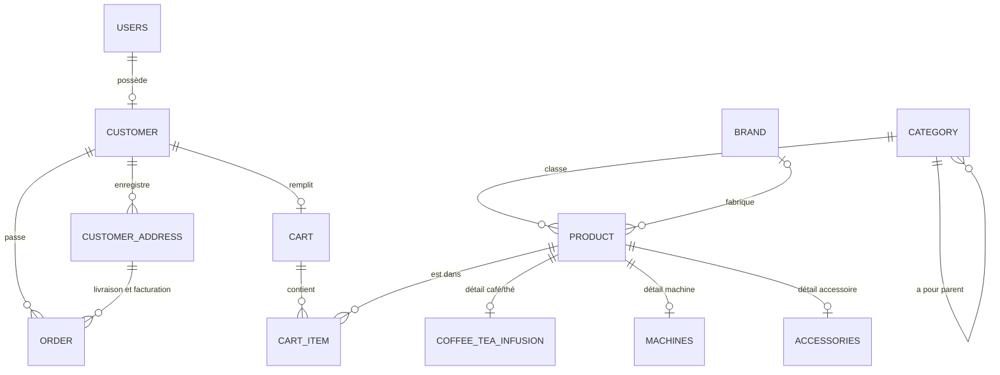

# 2. Maquettage et conception

## A. Charte graphique

La charte complète est dans `docs/brand-guideline.md` (11 sections). Je la reprends ici dans ses grandes lignes.

### L'idée

Le logo associe une tasse et une horloge : le temps d'une tasse. Tout le site tourne autour de cette idée de pause. D'où quatre principes que j'ai écrits au début et que j'ai essayé de tenir jusqu'au bout :

| Principe | Ce que ça donne concrètement |
|---|---|
| Prendre le temps | De l'espace, peu de texte, un message fort par écran |
| Rester concret | L'origine, l'altitude, le profil aromatique : des faits, jamais de superlatifs |
| Soigner le geste | Des alignements nets, un état visible pour chaque bouton |
| Réchauffer sans bruit | Crème, brun, caramel, un seul accent vert, un mouvement discret |

### Couleurs

| Nom | Valeur | Variable CSS | Rôle |
|---|---|---|---|
| Crème | `#F3EBD9` | `--color-primary` | Fond des pages |
| Brun café | `#331B0A` | `--color-secondary` | Texte, titres, barre de navigation |
| Caramel | `#905B27` | `--color-tertiary` | Boutons principaux, liens, icônes |
| Vert sapin | `#305847` | `--color-quaternary` | Accent, bouton « Commander » |
| Brun très foncé | `#1E0F05` | `--color-fifth` | Pied de page |

Proportions visées : environ 60 % crème, 25 % brun, 10 % caramel, 5 % vert et doré. Le texte courant est toujours brun sur crème, avec un contraste d'au moins 4,5:1.

Les couleurs secondaires (crème clair `#FAF5EA`, doré doux `#D9A566`, beige `#B9A98F`, rouge `#C1121F`) sont utilisées dans le code mais elles ne sont pas encore déclarées en variables CSS. C'est un des écarts que j'ai listés à la fin de la charte.

### Typographie

- **Playfair Display** (serif) pour les titres et le nom de la marque.
- **Lato** (sans-serif) pour le texte courant et les interfaces.

Dans le code, ce n'est pas encore homogène : Playfair Display et Lato sont chargées dans certains fichiers (le panier par exemple), mais `style.css` importe Roboto et définit une pile Lucida Sans pour le `body`. Je l'ai noté dans la section « écarts » de `brand-guideline.md`. Deux familles, c'est le maximum que je voulais. L'audit Hallmark a d'ailleurs repéré que `settings.css` en déclare encore six à un endroit (Lato, Playfair, Arial, Roboto, Montserrat…). C'est du reste de mes essais que je n'ai pas nettoyé.

### Voix

Vouvoiement, phrases courtes, un bouton égale un verbe (« Ajouter au panier », « Commander »). Quelques phrases de référence : « Brûlerie artisanale en Provence. Grains sélectionnés à la source, torréfiés avec soin, livrés dans leur fraîcheur. » et « Livraison offerte dès 35 € d'achat. »

### Ce que j'ai vérifié avec l'audit

Le 24 octobre j'ai fait passer le frontend dans un audit (`docs/audit-hallmark.md`, rapport brut dans `frontend/.hallmark/`). Résultat : 163 échecs, 169 « réflexes » et 13 avertissements sur 47 fichiers et 3 pages. Ça fait beaucoup dit comme ça. En lisant le détail, la plupart viennent de deux causes : les couleurs et les espacements écrits en dur (99 et 139 occurrences) et le responsive. J'ai corrigé le responsive en priorité (branches `fix/responsive`, `fix/responsive-2`), parce que c'était ce qui cassait l'usage. Le reste (variables CSS, grille d'espacement de 4 px) est dans mes perspectives.

[CAPTURE : planche de la charte (logo, palette, typo) exportée de Figma ou du fichier `brand-guideline.md`.]

---

## B. Maquettage

Je suis passée par trois niveaux, comme demandé : wireframes, maquettes, prototype.

### Wireframes

Fichiers : `docs/wireframes.md`, `docs/wireframes.html`, images dans `docs/wireframes/`. Chaque page existe en version bureau et en version mobile (sous 900 px). Pour les produire j'ai écrit un prompt par type de rendu (`Prompt_Figma_Wireframes.md`) pour rester cohérente d'une page à l'autre.

Pages dessinées :

| N° | Page | Route |
|---|---|---|
| 01 | Accueil | `/` |
| 02 | Catégorie (liste de produits + filtres) | `/collection-…` |
| 03 | Fiche produit | `/produit/:id` |
| 04 | Panier (plein et vide) | panneau latéral |
| 05 | Connexion et inscription | modale |
| 06 | Espace client | modale |
| 07 | Sous-menus de la navigation | survol de la barre |

Le document `wireframes.md` commence par un plan du site avec les routes et les composants React associés, ce qui m'a servi de pense-bête au moment de coder.

Choix que j'ai faits dès les wireframes :

- **Le panier est un panneau latéral**, pas une page. Un ajout ouvre le panneau, ce qui confirme l'action sans quitter la fiche produit.
- **La connexion est une modale**, pas une page. Un visiteur qui clique sur « Ajouter au panier » sans être connecté voit le panneau l'inviter à se connecter, et son article est gardé en mémoire pour l'ajouter après la connexion.
- **L'espace client aussi est une modale**, avec ses onglets (informations, adresses, achats, sécurité).

### Maquettes

Fichiers : `docs/mockups/`, 20 images (8 pour le bureau, 12 pour le mobile) et les sources HTML dans `docs/mockups/src/`. Les maquettes appliquent la charte : crème, brun, caramel, Playfair Display pour les titres. Les prompts sont dans `Prompt_Figma_Maquette.md` et `Prompt_Figma_Maquette_Mobile.md`.

[CAPTURE : insère ici 3 maquettes : `desktop-01-accueil.png`, `desktop-03-fiche-produit.png`, `mobile-05-panier.png`.]

### Prototype

[À COMPLÉTER : si tu as un prototype Figma cliquable, mets le lien et dis quel parcours il couvre (par exemple : accueil, catégorie, fiche produit, ajout au panier, connexion). Si tu n'en as pas fait, écris-le : le site déployé sert alors de prototype fonctionnel, et c'est une réponse acceptable.]

### Un écart honnête entre maquette et site

La maquette 07 (sous-menus) a été modifiée dans le dépôt récemment et le fichier `desktop-07-sous-menus.png` n'est plus dans `docs/mockups/` (il reste dans `docs/wireframes/`). Je corrigerai les renvois avant le rendu.

---

## C. Modélisation de la base de données

### Méthode

Je suis partie des user stories pour lister les « choses » dont le site a besoin (utilisateur, client, adresse, produit, catégorie, marque, panier, commande), puis j'ai posé les relations et les cardinalités.

> **Remarque sur la source.** Le script initial de création des tables n'est pas dans le dépôt : j'ai créé la base à la main avant d'écrire les migrations. Le schéma ci-dessous est reconstitué à partir des requêtes SQL du back-end (`backend/constantes/`) et des migrations (`database/`). [À FAIRE : exporter le schéma réel avec `mysqldump --no-data` et le placer dans `database/schema.sql`. C'est aussi ce que je dois mettre en annexe.]

### MCD (modèle conceptuel)

Règles de gestion principales :

- Un **utilisateur** (compte) a **0 ou 1** fiche client. Une fiche client a **0 ou 1** compte (0 pour un invité).
- Un **client** a **0 ou plusieurs** adresses, dont une seule par défaut.
- Un **client** a **0 ou 1** panier et **0 ou plusieurs** commandes.
- Un **panier** contient **0 ou plusieurs** produits, avec une quantité pour chacun.
- Un **produit** appartient à **exactement 1** catégorie et à **0 ou 1** marque.
- Une **catégorie** peut avoir une catégorie parente (arborescence à un niveau : « Café en grain » est le parent de « café en grain grand cru »).
- Un produit a des caractéristiques propres à son type : café, thé et infusion partagent une table ; les machines et les accessoires ont chacune la leur.



### MLD et MPD (modèles logique et physique)

**Pourquoi je les regroupe.** Le MLD et le MPD décrivent la même chose, les mêmes tables, les mêmes colonnes et les mêmes clés. Seul le niveau de détail change : le MLD ne dépend d'aucun SGBD, le MPD ajoute les types et les contraintes de MySQL. Sur ce projet, le SGBD est fixé dès le départ (MySQL 8.4, pas de changement prévu) et le schéma est petit : un MPD séparé aurait recopié le MLD en ajoutant seulement une colonne « type ». Les garder ensemble évite deux versions à maintenir à chaque migration, et le lecteur voit la structure et son implémentation au même endroit.

**Côté logique.** Clés primaires indiquées par `PK`, clés étrangères par `FK`.

```
users (PK user_id, username, email [unique], password, role, is_active, created_at, updated_at)

customer (PK customer_id, FK user_id [unique, nullable → users], first_name, last_name,
          customer_email, phone, birth_date)

customer_address (PK address_id, FK customer_id → customer, address_name, is_default,
                  street, city, postcode, country)

category (PK category_id, category_name, FK parent_id [nullable → category])

brand (PK brand_id, brand_name)

product (PK product_id, FK category_id → category, FK brand_id [nullable → brand],
         product_name, product_description, product_image_url, price, stock)

coffee_tea_infusion (PK/FK product_id → product, origin, roast, grind_type, intensity, weight)

machines (PK/FK product_id → product, technology, pressure_power, grinder, tank_capacity)

accessories (PK/FK product_id → product, usage, material, capacity, color)

cart (PK cart_id, FK customer_id → customer, cart_creation_date)

cart_item (PK/FK cart_id → cart, PK/FK product_id → product, quantity)

order (PK order_id, FK customer_id → customer,
       FK shipping_address_id → customer_address, FK billing_address_id → customer_address,
       order_number, order_date, order_total_price, order_status, payment_method, shipping_cost)
```

**Côté physique.** Le SGBD est MySQL 8.4. Types et contraintes principaux :

| Table | Colonne | Type | Contrainte |
|---|---|---|---|
| users | user_id | INT | clé primaire, auto-incrément |
| users | email | VARCHAR | unique, non nul |
| users | password | VARCHAR | non nul, contient le hash bcrypt |
| users | role | VARCHAR | `USER` ou `ADMIN` |
| users | is_active | BOOLEAN | `TRUE` par défaut |
| customer | user_id | INT | unique, nullable, clé étrangère vers users |
| customer | first_name, last_name | VARCHAR(150) | non nul |
| customer | birth_date | DATE | nullable |
| customer_address | is_default | TINYINT(1) | non nul, 0 par défaut |
| product | price | DECIMAL | non nul |
| cart_item | (cart_id, product_id) | INT, INT | clé primaire composée |
| coffee_tea_infusion | intensity, weight | DECIMAL | intensité de 0 à 10 dans le jeu de données |

[À FAIRE : remplacer ce tableau par le `SHOW CREATE TABLE` réel de chaque table, une fois le `mysqldump --no-data` fait. Les longueurs de VARCHAR et les types exacts de `price` et `order_status` doivent venir de la base, pas de ma mémoire.]

**Conventions de nommage.**

- **Tables** : `snake_case` au pluriel (ex. `users`, `order_items`).
- **Champs** : `snake_case` au singulier (ex. `first_name`, `created_at`).
- **Clés primaires** : `<table>_id` (ex. `product_id`). Une clé étrangère porte le même nom que la clé qu'elle référence (`category_id` dans `product`), sauf quand une table pointe deux fois vers la même (`shipping_address_id` et `billing_address_id` dans `order`).
- **Booléens** : préfixe `is_` (ex. `is_default`, `is_active`).

[À FAIRE : vérifier que cette règle reflète bien le schéma. Aujourd'hui, `users`, `machines` et `accessories` sont au pluriel, mais `customer`, `product`, `category`, `brand`, `cart` et `order` sont au singulier, et les dates ne suivent pas toutes le même motif (`created_at`, `order_date`, `cart_creation_date`). Soit je renomme, soit j'écris ici que c'est un écart connu.]

### Les choix que j'assume

**Séparer `users` et `customer`.** C'est la décision qui m'a coûté le plus. Au départ, j'avais tout mis dans `users` : prénom, nom, téléphone, date de naissance, en plus de l'email et du mot de passe. Ça marche jusqu'au moment où on veut des commandes pour un client qui n'a pas de compte, ou un admin qui n'a pas de fiche client. J'ai donc coupé en deux : `users` pour *qui peut se connecter*, `customer` pour *qui achète et où livrer*. Il a fallu écrire une migration (`database/migration_users_customer.sql`) qui copie les données, renomme `user_email` en `email`, supprime les anciennes colonnes et vérifie qu'aucun compte ne reste sans fiche. J'ai fait une sauvegarde avant de la lancer.

**Un héritage par tables de détail.** Plutôt qu'une seule table `product` avec 20 colonnes dont la moitié vides, les caractéristiques spécifiques sont dans `coffee_tea_infusion`, `machines` et `accessories`, reliées par `product_id`. La lecture du catalogue fait des `LEFT JOIN` vers ces trois tables. Le défaut : la requête est longue et chaque nouveau type de produit demande une nouvelle table.

**`LEFT JOIN` vers la marque.** Une marque est facultative. Avec un `JOIN` simple, un produit sans marque disparaîtrait silencieusement de la liste. J'ai mis un commentaire dans le code pour ne pas me refaire piéger.

**Clé composée sur `cart_item`.** Le couple (panier, produit) est unique. Ça permet d'écrire `INSERT … ON DUPLICATE KEY UPDATE quantity = quantity + VALUES(quantity)` : si le produit est déjà dans le panier, sa quantité augmente au lieu de créer une deuxième ligne.

**Adresse par défaut.** Une colonne `is_default` ajoutée par une seconde migration (`database/migration_default_address.sql`). La migration promeut la plus ancienne adresse de chaque client en adresse par défaut, puis une requête de vérification contrôle qu'il y en a bien une seule par client.

### Ce qui manque au modèle

Il n'y a pas de table de lignes de commande (`order_item`). Une commande garde son total, son statut et ses adresses, mais pas la liste détaillée de ce qui a été acheté. Pour une vraie boutique c'est un trou : il faudrait copier le prix et la quantité de chaque produit au moment de l'achat, pour que l'historique ne change pas quand un prix évolue. C'est la première chose que j'ajouterais.

[CAPTURE : le MCD dessiné proprement (Looping, Mocodo ou draw.io) et le diagramme du MLD généré par l'IDE.]
